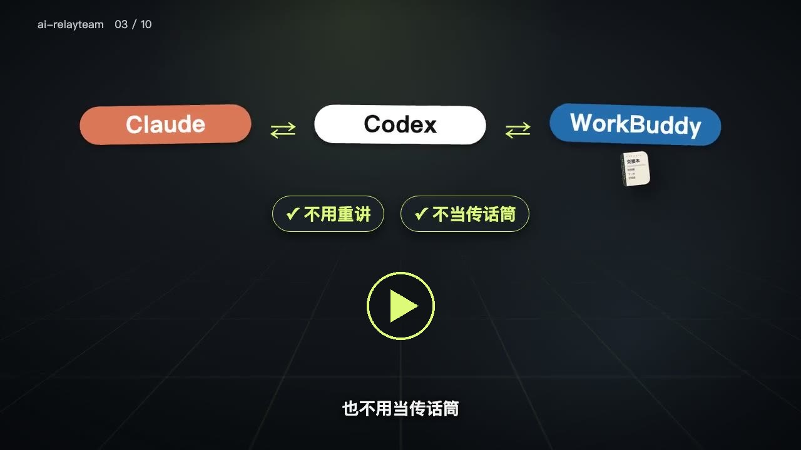

# AI 接力队（ai-relayteam）

**换 AI，活不停；多个 AI，会分工。**

[](docs/media/promo.mp4)

▶ 点图片看 86 秒宣传片（中文配音）：用一个「读书清单」小项目，真实录屏演示换 AI 接着干、多个 AI 分工。

> 一本放在项目里的「交接本」。不管换哪个 AI、开几个新窗口、隔多久回来，AI 打开项目就知道：做到哪了、下一步做什么、哪些事不能碰。你只管拍板。

---

## 你一定遇到过

- **额度用完了。** 刚把需求跟 Claude 讲明白，额度没了。换成 Codex，又得从头讲一遍。
- **新开一个窗口，AI 失忆了。** 昨天做到哪、为什么这么定、哪些方案已经否掉了，它全不记得。
- **你成了传话筒。** 让一个 AI 写方案、另一个 AI 动手，你在中间来回复制粘贴，比自己干还累。
- **AI 太自作主张。** 你只是说了句「继续」，它就开始大改代码、提交、甚至删文件。

这些问题的根子是同一个：**工作的状态只存在聊天记录和 AI 的脑子里**。聊天一换，状态就没了。

## 它是什么

一句话：**把「工作做到哪了」从聊天记录里搬出来，写进项目里的几个文件。**

就像医院护士换班要写交接本、工地每天要记施工日志，接班的人不用问前一个人，翻开本子就能接着干。AI 也一样：

| 文件 | 相当于 | 里面写什么 |
| --- | --- | --- |
| `AGENTS.md` | **员工守则** | 谁是负责人、谁干活；换人怎么交接；哪些事必须先问你（花钱、删除、对外发布） |
| `HANDOFF.md` | **交接本** | 现在在做什么、做到哪了、**唯一的下一步**是什么 |
| `STATUS.md` | **成绩单** | 哪些事已经做成、有什么证据；哪些还没做 |

主流 AI 编程助手打开项目时，会自动读 `AGENTS.md`（这是一个开放约定，Claude Code 通过一行 `CLAUDE.md` 读到它）。所以你不用每次跟 AI 解释，它自己会去看。

## 用了之后什么样

| 以前 | 现在 |
| --- | --- |
| 换个 AI，从头讲一遍需求 | 新 AI 打开项目，自己读交接本，直接说出做到哪、下一步是什么 |
| AI 读一大堆历史记录才能接手 | 交接本只写「现在」，几页纸就够（我们自己的项目：接手要读的内容从约 31 万字节减到约 1.2 万字节，少了 96%） |
| 你在两个 AI 之间复制粘贴 | 负责人 AI 直接派活给干活的 AI，取回结果、检查完再向你汇报 |
| 说句「继续」，AI 就开始乱改 | 「继续」只是让它汇报进度；动手之前必须等你点头 |
| 负责人 AI 额度用完，工作停摆 | 另一个 AI 按守则临时接班，原负责人回来后先检查它改了什么，再交回 |

## 三种用法，按需选

**① 只用一个 AI（大多数人从这里开始）**
你平时只用 Claude Code、Codex、WorkBuddy 等某一个 AI 编程助手。放上交接本之后，换窗口、隔几天回来都能接着干，不用重新解释。

**② 一个负责人 + 一个干活的**
比如：**Claude 负责人**（想方案、拆任务、检查结果）+ **Codex 干活**。Claude 负责人直接在后台派活给 Codex，取回结果检查完再向你汇报，你不用当传话筒。好处是分工清楚，也更省额度。
AI 每次汇报都会先报身份（比如「Claude 负责人：……」），你随时知道现在是谁在负责。

**③ 多个干活的**
排好顺序：第一个 AI 额度用完或出错，负责人按守则换下一个，并且告诉你换了谁、有没有花钱。

用哪种、谁当负责人，都是你在 `AGENTS.md` 里写一行字决定的，随时可以改。

## 一句话安装（不需要会编程）

先用你的 AI 编程助手**打开项目文件夹**（新项目就先建一个空文件夹再打开），然后把下面这句话发给它：

```text
请按 https://github.com/clarkzoe2026-a11y/ai-relayteam/blob/main/INSTALL.md 的说明，把交接本装进我当前的项目。
```

剩下的交给 AI：它会下载模板、先读你的项目自己推断情况，然后只问你两三个问题（用哪个 AI、你的习惯、它推断的进度对不对），填好后给你确认。你已有的文件它不会覆盖。

装好之后，不管换哪个 AI、开新窗口，说一句「继续」就能接上。每做完一段，让 AI 把进度写回 `HANDOFF.md`。

<details>
<summary>想自己动手装？（手动安装）</summary>

1. 在本页点绿色的「Code」按钮 →「Download ZIP」，解压。
2. 把 `templates` 文件夹里的 5 个文件复制到你的项目文件夹。
3. 打开 `AGENTS.md`，在「当前配置」写上你用哪个 AI，把「用户偏好」改成你的习惯；打开 `HANDOFF.md`，把示例换成你项目的真实目标、进度和下一步。
4. 用 AI 打开项目，说「继续」。

</details>

## 两个可选小工具

不装也能用。装了更省心：

- **防泄露守门员**：每次提交代码前，自动检查提交人信息，防止你的真名、私人邮箱被传到网上。
- **自动备份进度**：交接本一改，就自动同步到你的 GitHub。电脑坏了、换电脑，进度都还在。目前只支持 Mac。

安装方法见 [防泄露守门员](docs/identity-guard.md) 和 [自动备份进度](docs/sync.md)。

## 实话实说

- **它是一套方法加两个小工具，不是一个装上就自动运行的软件。** 起作用靠的是 AI 读文件、守规矩。主流 AI 编程助手大多会照做，但 AI 偶尔也会犯错，所以关键操作都设计成「先问你」。
- **我们实测过的组合**：Claude Code 当负责人、Codex 干活。其他组合（比如 Codex 当负责人、或者用别的 AI）照规则应该可行，但还没实测，详见 [三种模式](docs/modes.md) 和 [派活方式](docs/dispatch.md)。
- 「一句话安装」用 Codex 和 WorkBuddy 实测过：读项目、一轮问清、装好 5 个文件、不覆盖、不擅自提交，新窗口说「继续」能接上。公开后又用网址完整测了一次（Codex，从 GitHub 下载模板），同样通过。
- 自动备份进度目前只支持 Mac。
- 这套做法来自我们自己每天的真实工作：先在自己的项目上用起来、踩过坑，再整理出来分享。

## 常见问题

**需要会编程吗？**
不需要。把一句话发给你的 AI 就能装好，两个可选小工具也由 AI 帮你装。

**支持哪些 AI？**
会读项目里这几个文件的 AI 编程助手都能用。Codex 等原生读取 `AGENTS.md`，Claude Code 通过一行 `CLAUDE.md` 读取。实测情况：Claude Code、Codex 全部用法都实测过；WorkBuddy 也实测过：用一句话安装成功，新开窗口说「继续」会读守则和交接本、先报身份、等你点头再动手（当时文件夹里有 WorkBuddy 自己的记忆，没能完全排除记忆的帮助；万一它没读，开头说一句「先读 AGENTS.md」即可）。

**会额外花钱吗？**
这套东西本身免费（MIT 许可证）。AI 用的还是你自己的套餐额度。守则里写明了：任何会产生费用的操作，AI 必须先问你。

**我的项目内容会被上传吗？**
不会。所有文件都在你自己的电脑和你自己的仓库里。只有你装了「自动备份进度」，才会把进度文件同步到你自己的 GitHub。

**和 AI 自带的「记忆」功能有什么区别？**
AI 自带的记忆只在它自己那里，换一个 AI 就没了，你也看不到它记了什么。交接本是写在项目里的普通文件：你看得见、改得了，换哪个 AI 都能读。

## 相关项目

做类似事情的开源项目不止我们一个。它们各有长处，按需选用：

| 项目 | 做什么 | 和 AI 接力队的区别 |
| --- | --- | --- |
| [agent-handoff-kit](https://github.com/Adamchanadam/agent-handoff-kit) | 「Session 接力棒」：把进度、决定、下一步写成项目文件，让不同 AI 跨对话接着干；有常用指令和可视化面板 | 专注「接得上」，功能更多，需要 Node.js |
| [relay-between-agents](https://github.com/Gwendolenmave/relay-between-agents) | 一个 AI 规划、另一个 AI 施工，人不再夹在中间复制粘贴 | 专注「分工」这一半 |
| [agent-baton](https://github.com/codeprakhar25/agent-baton) | 监控 Claude Code / Codex 额度，快用完时提醒并自动写交接 | 专注「额度用完」这个时刻，需要装 npm 包 |
| [tagteam](https://github.com/cephalopod-ai/tagteam) | 一条命令调度多个编程 AI：主管写任务并审查、工人实现，循环到通过 | 命令行程序，在终端里跑 |

**AI 接力队的不同**：把「换 AI 接得上」和「多个 AI 会分工」放在同一套规则里；负责人 AI 额度用完时有临时接任和交还的规则；不装任何程序，复制 5 个文本文件就能用。

## 文档

- [三种模式怎么选、怎么填](docs/modes.md)
- [负责人怎么派活给其他 AI](docs/dispatch.md)
- [换人规则：AI 不可用时怎么交接](docs/handover.md)
- [多个项目同时做](docs/multi-project.md)
- [来源标注：怎么区分「真做成了」和「AI 说做成了」](docs/provenance.md)

English: [README.en.md](README.en.md)

许可证：[MIT](LICENSE) —— 免费使用、修改、分享。
